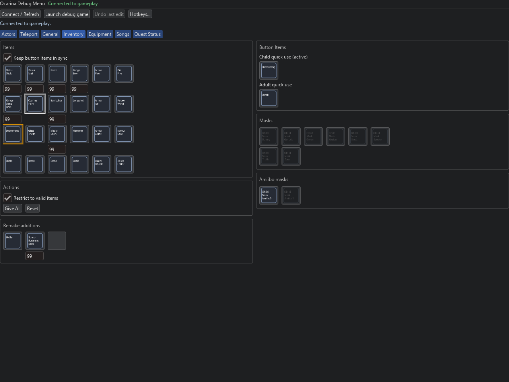
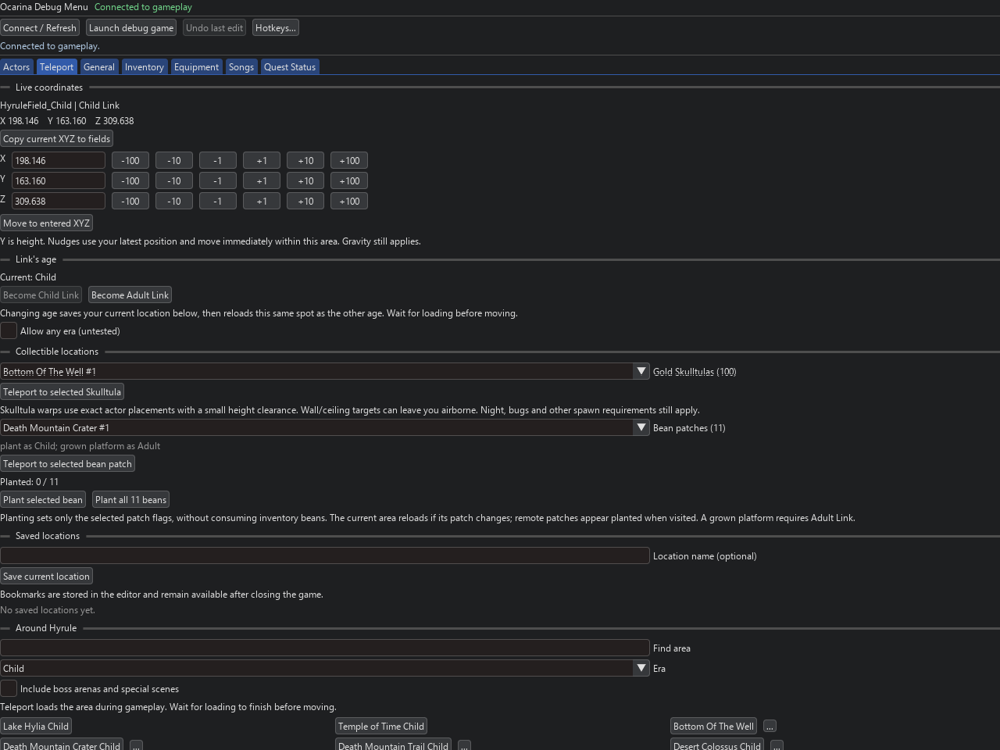

# OOT Debug Menu
Demo video: https://youtu.be/XdKqxSuwbg0
A standalone Dear ImGui companion for live inventory, equipment, songs,
teleports, free-flight camera, age switching, position editing and actor exploration in the inspected
Ocarina of Time revision. Windows x64 is the currently tested platform.

## Play with the portable download

Download **OOT-Debug-Menu-Mainline-Win64.zip** or
**OOT-Debug-Menu-Optimized-Win64.zip** from [Releases](https://github.com/sphayes1/oot-debug-menu/releases).
Use **Extract All**, open the extracted folder and double-click
**Start Ocarina + Debug Menu.cmd**. First-run Setup asks for your game and keys.
Load gameplay, then click **Connect / Refresh** in the debug menu.

**[Follow the step-by-step getting-started guide](docs/GETTING-STARTED.md)** for
download choices, keyboard/controller setup, saving and troubleshooting.
Python is included in the portable packages.

## Screenshots

Inventory and teleport menus from the public client, connected to gameplay.
Click an image to view it at full size.

| Inventory and quick-use items | Coordinates, age and teleports |
| --- | --- |
| [](docs/screenshots/inventory.png) | [](docs/screenshots/teleport.png) |

**[See all nine menu screenshots](docs/SCREENSHOTS.md)**, including the actor
catalogue, equipment, songs, free camera, controller settings and collision controls. These are menu-only captures
from the renderer, without a mouse pointer or computer-use overlay. Public
downloads use original text badges instead of extracted item artwork.

This repository owns the debug client, game-side debug patch recipes and the
emulator write-bridge delta. Rendering fixes, shader changes, FPS patches,
timing experiments, PGO builds and performance profiles are separate projects.
The launcher sets only three debug-service environment variables and storage
paths; it preserves rendering and input settings from the INI you provide.

## Features

- Live inventory, equipment, bottles, ammunition and capacity editing.
- Fairy Ocarina / Ocarina of Time use support and all 12 standard song unlocks.
- Area/entrance teleports and persistent custom location bookmarks.
- Child/Adult switching with captured scene, position and facing restoration.
- Live XYZ reading/editing and per-axis ±1, ±10 and ±100 nudges.
- Free-flight debug camera and Teleport Link to camera, with keyboard/mouse controls.
- [Customizable controller shortcuts](docs/CONTROLLER.md) and twin-stick camera flight;
  LB + Minus enters, B exits, A teleports and exits; four shoulders + D-pad Left/Right saves/loads.
- [Collision overlay](docs/COLLISION.md) while controlling Link or flying the debug camera;
  reads geometry from your NUP automatically, with surface/zone filters and X-ray.
- 100 Gold Skulltula and 11 bean-patch destinations; selected/all-bean planting.
- 8,373 indexed actor definitions and 120,834 original placement records, with
  name/type/area/era/physics filters and placement teleports.
- 51 hand selected dynamic actor definitions, including 13 chest variants.
- Direct native game checkpoints on **F5** (save) / **F6** (load), with configurable
  keyboard and controller bindings. No menus or confirmation inputs. Loading
  reloads the area; these are not full emulator save states.
- Explicit opt-in cross-era item and teleport overrides.

## Compatibility

This is a companion, not a standalone emulator or a performance build.
Live writes require a compatible Lichii/Eden-derived emulator debug service.
An ordinary emulator build without that service cannot connect. The current
reference bridge and game schema are revision-pinned; arbitrary game updates
are deliberately rejected. See [emulator bridge](emulator-bridge/README.md).

The original working private portable bundle remains separate. This first public
source release does not bundle an emulator executable, game container, keys,
save progress, extracted item artwork or performance mods. The default UI draws
original text badges in place of extracted item sprites.

Portable binaries are prepared in two variants, **Mainline** and **Optimized**,
using the same debug-client code. Their emulator and profile inputs stay separate;
see [release variants](docs/RELEASES.md). The current mainline target is official
Lichii build117 with only the guarded debug bridge added.

## Developer setup from source

Install 64-bit Python 3.10, then run **Setup Python.cmd**, or:

```powershell
py -3.10 -m venv .venv
.venv\Scripts\python -m pip install -r requirements.txt
.venv\Scripts\python tools\prepare_data.py
```

Close the emulator and prepare a separate debug profile using your own supported
NUP and compatible emulator. Keys remain configured in your emulator separately.
Pass an SDL2 INI for your preferred controller/input settings; its rendering
settings are preserved. Paths in this example are placeholders:

```powershell
.venv\Scripts\python tools\setup_game.py --nup "D:\Games\Ocarina.nup" --emulator "D:\Emulator\eden-cli.exe" --config "D:\Emulator\sdl2-config.ini"
```

Setup verifies source-member hashes and generates only the six debug override
files in `editor/runtime/load`. Original game files are read only. It starts an
empty, independent NAND profile; no existing save is imported or overwritten.
To use existing progress, close the game and copy your save into that profile.

Run **Start Debug Game.cmd** to launch the configured emulator and menu. Load
gameplay, then select **Connect / Refresh**. **Start Debug Menu.cmd** opens just
the companion for a session already launched by this project's launcher.

Local keys, configuration, bookmarks, logs, saves, bindings and generated files
are ignored by Git. The connection is loopback-only at `127.0.0.1:6545` and
requires this project's session and dump-directory identity.

## Development

```powershell
.venv\Scripts\python run.py --self-check
.venv\Scripts\python -m unittest discover -s editor -p "test_*.py"
```

The normal suite needs no game and performs no live emulator writes. Save-parser
tests construct synthetic typed tables. One optional recognition test uses
private screenshots and skips when absent. See [architecture](docs/ARCHITECTURE.md),
[file guide](docs/FILE-GUIDE.md) and [contributing](CONTRIBUTING.md).

Actor locations are original map placements, not a live actor-position feed.
Runtime-spawned actors may have no fixed destination. Additional dynamic matches
and cross-era behavior need gameplay testing. Song removal/custom Scarecrow tunes
are not implemented. Direct checkpoints use the game's native save system and reload the area.

## License and provenance

GPL-3.0-or-later; see [LICENSE](LICENSE) and
[third-party notices](THIRD-PARTY-NOTICES.md). The design is inspired by Ship of
Harkinian's debug tools; this is an independent companion for a different runtime.
