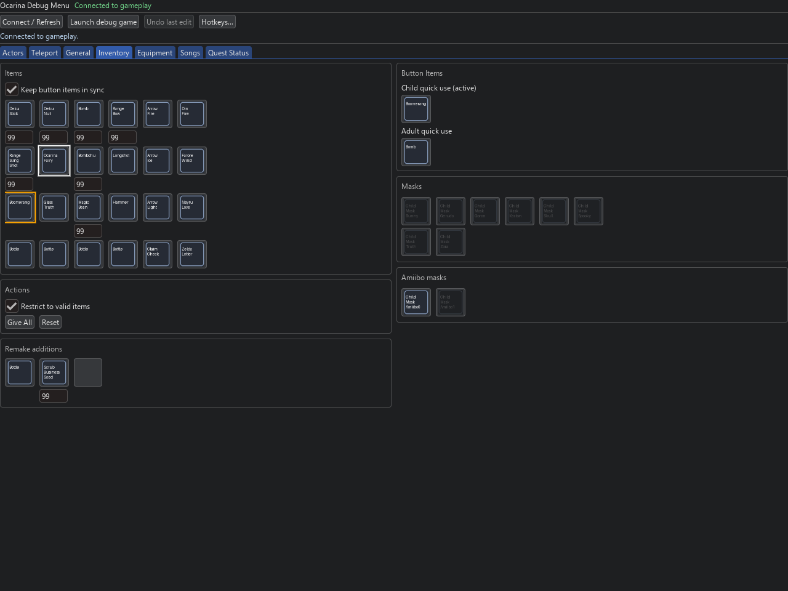
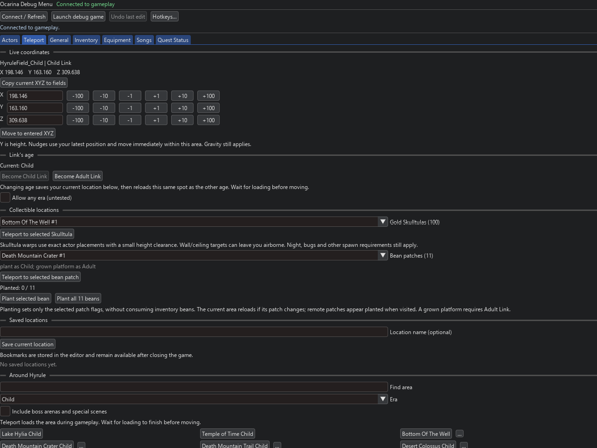
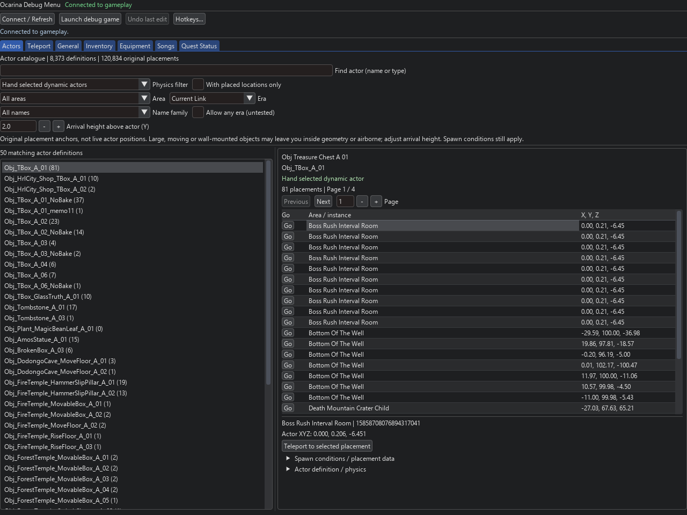
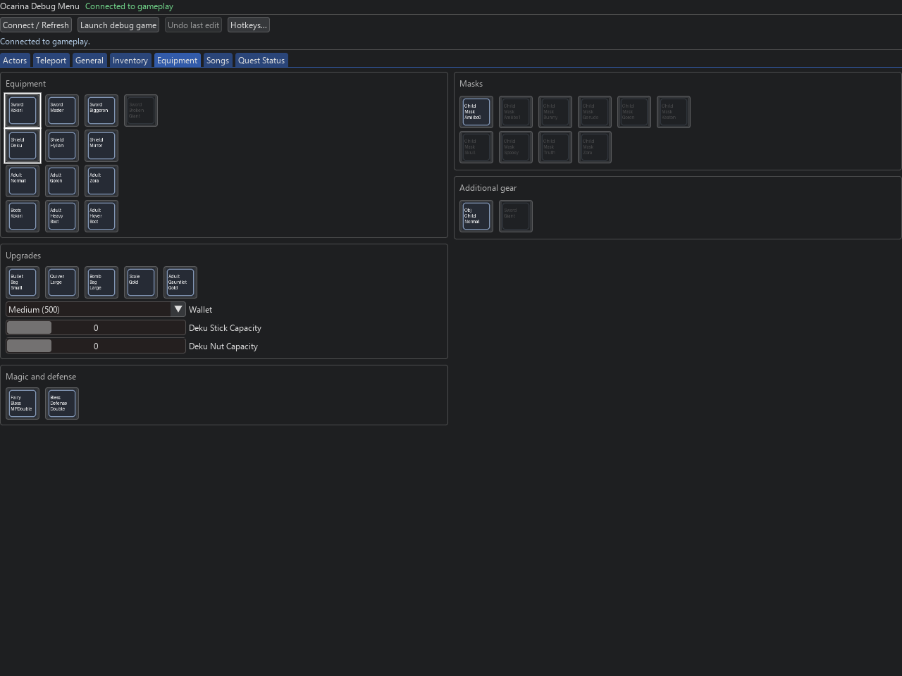
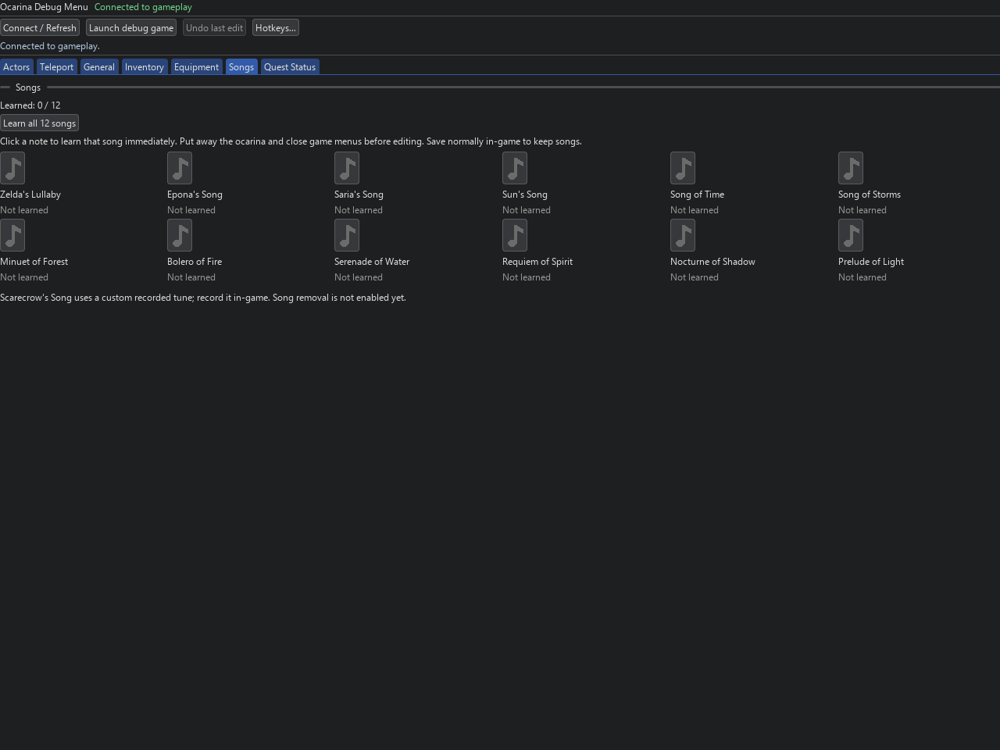
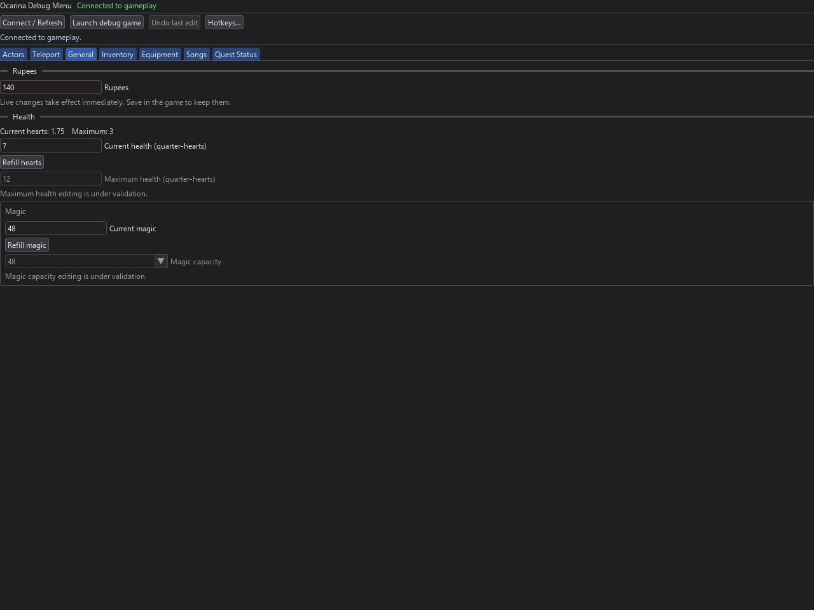
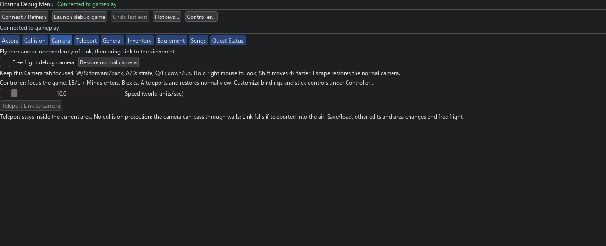
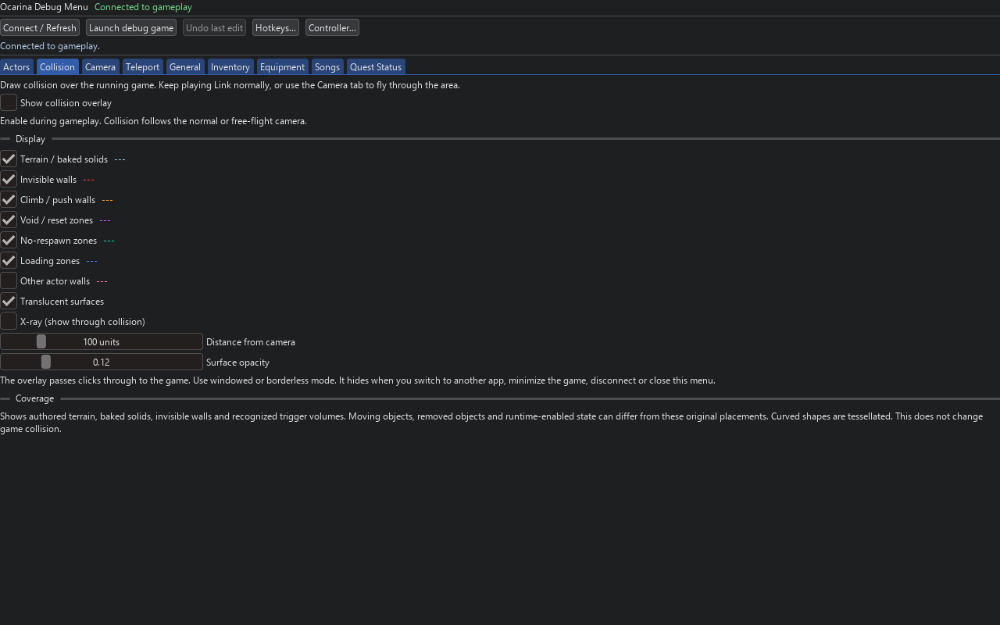
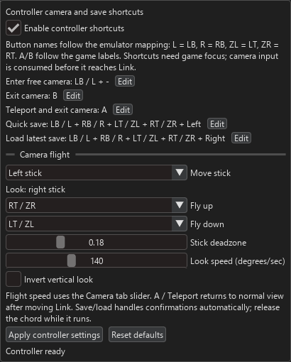

# Debug menu screenshots

These show the public debug client connected to a real, isolated gameplay
session. They are exported directly from the menu renderer, so they contain
only the interface: no desktop, game window, cursor or click highlight.
The public client uses original text badges instead of extracted game artwork.
Click an image for the full-size view.

## Inventory

Item ownership, ammunition, bottles, quick-use assignments and item restrictions.

[](screenshots/inventory.png)

## Teleport, coordinates and age

Live XYZ controls, instant nudges, child/adult switching, collectible destinations,
bean planting, custom bookmarks and area teleports.

[](screenshots/teleport.png)

## Actor catalogue

The hand selected dynamic actors filter with a treasure chest selected, showing
its original map placements and teleport controls.

[](screenshots/actors.png)

## Equipment

Swords, shields, tunics, boots, masks, upgrades and capacity controls.

[](screenshots/equipment.png)

## Songs

All 12 standard songs, individual unlocks and the Learn all 12 songs button.

[](screenshots/songs.png)

## General

Rupees and current health/magic controls. Fields that remain under validation
are visibly disabled in the interface.

[](screenshots/general.png)

## Camera

Native free-flight toggle, movement speed, keyboard/mouse controls and teleport-to-camera.

[](screenshots/camera.png)

## Collision controls

Toggle a click-through gameplay overlay, select terrain/wall/zone layers and
adjust distance, translucent faces and X-ray. This screenshot shows the menu only.

[](screenshots/collision.png)

## Controller settings

Customize camera and save/load chords, stick assignment, up/down buttons,
deadzone, look speed and inversion. Controller names follow emulator mappings.

[](screenshots/controller.png)

## Refreshing the screenshots

Developers can export another tab from a configured public portable folder
while its game is loaded. Use this repository's Python environment:

```powershell
python tools/capture_screenshots.py --portable "C:/Games/OOT Debug Menu/OOT-Debug-Menu-Mainline-Win64" --tab Inventory --output docs/screenshots/inventory.png
```

The helper reads actual connected values and renders the existing menu widgets.
It does not invoke item-edit or teleport actions. It checks that the portable
folder uses the public generated badges. Regenerate `screenshots/manifest.json`
from the resulting `.capture.json` receipts when replacing the tracked images.
